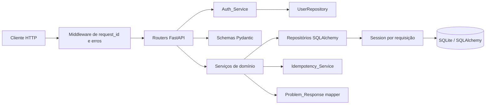
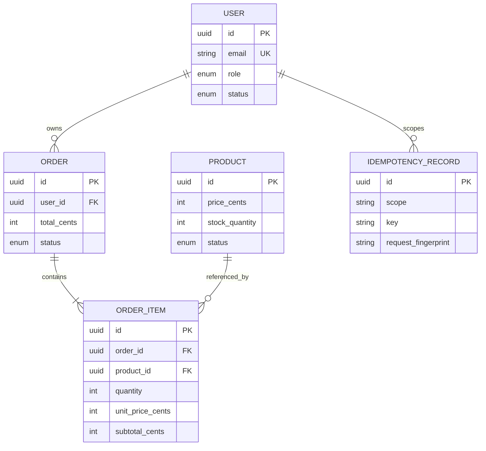

# Design Técnico: API ChocoMarket

## Overview

### Visão geral

A ChocoMarket é uma API REST para cadastro e administração de usuários, catálogo de chocolates, estoque e pedidos. Este design transforma os requisitos aprovados e o contrato `openapi.yaml` em uma arquitetura implementável sobre a base existente em FastAPI, SQLAlchemy e SQLite.

A implementação atual já fornece `POST /v1/users` para cadastro público de clientes. Ela persiste `UserModel` em SQLite, valida o corpo com Pydantic, normaliza o e-mail, usa Argon2 para proteger a senha, rejeita campos extras e nunca inclui a senha em `UserResponse`. O restante da evolução deve preservar esse comportamento e substituir regras incompletas, como a estrutura em memória `users_by_email`, por persistência e transações consistentes.

O escopo deste design inclui:

- autenticação de requisições Bearer e autorização por papel e status;
- operações de consulta, atualização, desativação e troca de senha de usuários;
- produtos, preços em centavos, estoque e exclusão lógica;
- criação, consulta e cancelamento de pedidos;
- transações atômicas para pedidos e estoque;
- paginação por cursor e filtros combináveis;
- idempotência para criações de usuários e pedidos;
- validação de contrato e respostas `application/problem+json`;
- testes unitários, de integração e baseados em propriedades.

O contrato HTTP é o `openapi.yaml`. Os schemas de entrada e saída devem permanecer separados para impedir que campos internos, especialmente `password` e seu hash, atravessem a fronteira HTTP. Os endpoints não devem ser inventados além do contrato. Em particular, este design valida tokens Bearer emitidos por um emissor configurado; a emissão de tokens não faz parte das rotas atualmente descritas no OpenAPI. Testes e ambientes locais usarão tokens assinados de fixture, e um endpoint de login só será adicionado se o contrato for ampliado posteriormente.

### Contexto técnico pesquisado

- A documentação do FastAPI descreve a validação do token Bearer, a verificação de assinatura e expiração de JWT e a separação entre o usuário autenticado e a dependência que verifica se ele está ativo. Essa abordagem informa o `Auth_Service` deste design: [FastAPI OAuth2 com JWT](https://fastapi.tiangolo.com/tutorial/security/oauth2-jwt/).
- A documentação do SQLAlchemy recomenda delimitar transações com `Session.begin()`, confirmando ao sair sem exceção e revertendo quando uma exceção ocorre. Isso informa a unidade atômica de criação e cancelamento de pedidos: [SQLAlchemy Session Transactions](https://docs.sqlalchemy.org/en/20/orm/session_transaction.html).
- A documentação do Pydantic estabelece a validação dos dados não confiáveis na entrada do modelo. O projeto já usa `ConfigDict(extra="forbid")` no cadastro e deve aplicar a mesma regra aos demais requests: [Pydantic Models](https://pydantic.dev/docs/validation/latest/concepts/models/).

## Architecture

### Arquitetura

A API seguirá uma arquitetura modular em camadas. O router conhece HTTP e dependências; o serviço concentra regras de negócio; os repositórios concentram consultas; os modelos SQLAlchemy representam persistência; os schemas Pydantic representam o contrato de entrada e saída.



### Organização proposta

A estrutura atual pode evoluir sem mover os arquivos já existentes:

```text
app/
  main.py
  database.py
  core/
    security.py
    auth.py
    errors.py
    pagination.py
    idempotency.py
  users/
    model.py
    schemas.py
    repository.py
    service.py
    router.py
  products/
    model.py
    schemas.py
    repository.py
    service.py
    router.py
  orders/
    model.py
    schemas.py
    repository.py
    service.py
    router.py
  common/
    models.py
    responses.py
    types.py
```

A criação das tabelas hoje ocorre em `lifespan` com `Base.metadata.create_all`. Para a evolução, as alterações de schema devem ser aplicadas com Alembic, já listado nas dependências. `create_all` pode permanecer apenas para um ambiente local vazio ou ser retirado quando as migrations forem a fonte única de schema. A configuração de banco deve continuar usando SQLite no ambiente atual, com `PRAGMA foreign_keys=ON`, índices adequados e uma estratégia de transação compatível com SQLite.

### Fluxo de uma requisição protegida

1. O middleware atribui ou propaga um `request_id` sem confiar em um valor arbitrário do cliente.
2. O router deixa o FastAPI validar path, query, headers e corpo.
3. `get_current_user` extrai o Bearer, valida assinatura, algoritmo, emissor, audiência e expiração, e localiza o usuário pelo `sub`.
4. A dependência rejeita usuário inexistente ou inativo com `401`; dependências de papel rejeitam papel insuficiente com `403`.
5. O serviço aplica autorização contextual, como permitir a um customer apenas o próprio pedido, e converte ausência de visibilidade em `404`.
6. O serviço consulta ou altera o banco por repositório.
7. O router serializa somente o schema de resposta definido no contrato.
8. Exceções de domínio são transformadas em `Problem_Response` e recebem `Content-Type: application/problem+json`.

### Decisões de autorização e visibilidade

A autenticação é baseada em JWT Bearer assinado. O token deve conter um identificador de usuário (`sub`) e, opcionalmente, claims de papel; a fonte de autoridade final será o registro atual no banco, para que alteração de papel ou desativação tenha efeito mesmo com token ainda não expirado. Um token válido para um usuário `inactive` continua resultando em `401`.

A autorização será composta por duas camadas:

- dependências `require_active_user` e `require_admin` para regras globais;
- verificações nos serviços para regras de propriedade e visibilidade.

Assim, clientes podem consultar produtos públicos ativos sem token, mas não podem consultar produtos indisponíveis, usuários de terceiros ou pedidos de terceiros. Administradores podem consultar registros inativos e todos os pedidos. Para evitar enumeração, um recurso existente mas invisível ao customer produz `404`, conforme o contrato.

### Concorrência e atomicidade

A criação e o cancelamento de pedidos usam uma única `Session` e um bloco `with session.begin()`. O serviço primeiro carrega e valida todos os produtos, depois bloqueia logicamente a decisão de estoque no mesmo escopo transacional, cria os itens e atualiza o estoque. Se qualquer validação falhar, nenhuma alteração é confirmada.

SQLite não oferece o mesmo bloqueio de linha de um banco servidor. O design deve habilitar uma transação de escrita imediata quando necessário e manter a seção crítica curta. A implantação que exigir concorrência de pedidos em múltiplos workers deve migrar para PostgreSQL mantendo as mesmas interfaces de serviço e repositório. O teste de concorrência deve confirmar que duas criações não conseguem consumir o mesmo estoque.

## Components and Interfaces

### Componentes e interfaces

### Routers FastAPI

Os routers expõem os caminhos do OpenAPI e não calculam totais, não fazem consultas SQL ad hoc e não decidem permissões por conta própria. Cada operação declara `response_model`, status de sucesso e dependências. Os módulos são:

- `users.router`: `POST /v1/users`, `GET /v1/users`, `GET/PATCH/DELETE /v1/users/{userId}` e `PATCH /v1/users/{userId}/password`;
- `products.router`: listagem, consulta, criação, atualização parcial e desativação de produtos;
- `orders.router`: listagem, criação, consulta e cancelamento de pedidos.

A operação pública `GET /v1/products` e a consulta pública de produto devem aceitar uma dependência opcional de usuário. Sem token, aplicam-se as mesmas visibilidades públicas de customer. Com token administrativo, a consulta inclui registros inativos e sem estoque quando permitido pelo contrato.

### Schemas de entrada e saída

Os schemas Pydantic devem refletir os limites do OpenAPI e usar `extra="forbid"`:

- users: `CreateCustomerRequest`, `UpdateUserRequest`, `ChangePasswordRequest`, `UserResponse`, `UserPage`;
- products: `CreateProductRequest`, `UpdateProductRequest`, `ProductResponse`, `ProductPage`;
- orders: `CreateOrderRequest`, `CreateOrderItemRequest`, `OrderResponse`, `OrderItemResponse`, `OrderPage`;
- comuns: `PageMeta`, `Problem`, `ValidationProblem` e tipos de cursor.

Requests de atualização devem diferenciar campo ausente de campo com valor nulo. Como o contrato não usa `null` para limpar campos, o schema deve rejeitar nulos onde o campo não for nullable e usar um modelo de patch que preserve somente os campos fornecidos. `response_model` deve impedir exposição acidental de colunas internas.

### Auth_Service

Interface conceitual:

```python
class AuthService(Protocol):
    def authenticate_bearer(self, authorization: str | None, db: Session) -> UserModel: ...
    def require_role(self, user: UserModel, role: UserRoleEnum) -> UserModel: ...
```

Responsabilidades:

- exigir o esquema `Bearer` nas rotas protegidas;
- validar token, algoritmo configurado, assinatura, expiração e claims mínimas;
- buscar o usuário por `sub` e confirmar status `active`;
- retornar erros `401` sem executar o handler;
- aplicar `403` quando o usuário autenticado não tem o papel requerido.

`app/core/security.py` já fornece Argon2 para hash e verificação de senha. A implementação deve manter esse algoritmo e mover segredo JWT, algoritmo, emissor e duração para configuração por ambiente, nunca para o código ou o banco.

### User_Service e UserRepository

O serviço preserva o fluxo atual de cadastro, mas passa a usar uma restrição única de banco para e-mail normalizado e um registro persistido de idempotência. A normalização ocorre antes da consulta e gravação. Operações de atualização verificam conflito dentro da mesma transação.

O repository oferece, no mínimo:

```python
get_by_id(db, user_id) -> UserModel | None
get_by_email(db, email) -> UserModel | None
list(db, filters, cursor, limit) -> Page[UserModel]
create(db, user) -> UserModel
update(db, user, changes) -> UserModel
```

A exclusão lógica apenas altera `status` para `inactive`. A troca de senha verifica o hash anterior antes de substituí-lo e nunca devolve o hash.

### Product_Service e ProductRepository

O produto tem estado derivado do estoque. Na criação, `stock_quantity > 0` produz `active` e zero produz `out_of_stock`. Em atualização, uma quantidade zero sempre produz `out_of_stock`; uma quantidade positiva reativa um produto que estava `active` ou `out_of_stock`, mas uma desativação explícita mantém `inactive` conforme a regra de exclusão lógica. A precedência deve ser codificada em uma função de domínio testável para evitar combinações ambíguas.

O serviço valida preço entre 1 e 1.000.000 centavos, estoque entre 0 e 1.000.000, nome entre 1 e 160 e descrição com no máximo 2.000 caracteres. A listagem pública aplica `status=active` por padrão. Filtros de administrador são combinados com `AND`.

### Order_Service e OrderRepository

Interface conceitual:

```python
class OrderService(Protocol):
    def create_order(self, db, owner_id, payload, idempotency_key) -> OrderResponse: ...
    def get_order(self, db, requester, order_id) -> OrderResponse: ...
    def cancel_order(self, db, requester, order_id) -> OrderResponse: ...
```

`create_order` executa esta sequência em uma transação:

1. calcula um fingerprint canônico do corpo validado e da operação;
2. consulta a `IdempotencyRecord` pela chave e pelo escopo do usuário/endpoint;
3. se houver registro, retorna o resultado original para fingerprint igual ou `409` para fingerprint diferente;
4. rejeita product IDs duplicados e valida todos os itens antes de alterar estoque;
5. carrega produtos ativos e confirma estoque suficiente;
6. captura `unit_price_cents` e calcula subtotais e total em inteiros;
7. reduz o estoque e cria `Order` e `OrderItem`;
8. grava o resultado serializado na idempotência;
9. confirma a transação e retorna `201`.

O cancelamento verifica autorização e estado, marca o pedido como `canceled` e devolve o estoque uma única vez no mesmo bloco transacional. Repetição sobre pedido cancelado não altera estoque.

### Pagination_Service

Um cursor opaco contém uma posição estável, o recurso, uma assinatura dos filtros e a identidade da visão autorizada. O cursor deve ser assinado com segredo da aplicação ou armazenar um token aleatório persistido; este design escolhe cursor assinado para não criar estado por página. O payload inclui a última chave de ordenação, por exemplo `(created_at, id)`, e expiração curta.

A consulta sempre ordena de modo determinístico por `created_at, id`, aplica filtros e visibilidade antes do cursor e busca `limit + 1`. Os primeiros `limit` itens formam `data`; o item extra determina `has_next` e `next_cursor`. Um cursor de outro recurso, filtros diferentes, usuário diferente ou assinatura inválida retorna `422`.

### Idempotency_Service

Interface conceitual:

```python
class IdempotencyService(Protocol):
    def fingerprint(self, method, path, authenticated_user, body) -> str: ...
    def replay_or_conflict(self, db, scope, key, fingerprint) -> StoredResult | None: ...
    def store_result(self, db, scope, key, fingerprint, result) -> None: ...
```

A chave deve ter de 16 a 128 caracteres. O escopo inclui usuário autenticado, método e rota para impedir que a mesma chave de uma operação seja reutilizada em outro contexto. O fingerprint usa JSON canônico com ordenação de chaves e representação estável de UUIDs e inteiros. O registro é criado na mesma transação do recurso para que não exista chave gravada sem resultado ou resultado sem chave. Cadastro público usa um escopo público separado e continua protegido também pela restrição única de e-mail.

### Error_Handler

Um handler global trata erros de validação FastAPI/Pydantic, exceções de domínio, conflitos de unicidade e falhas inesperadas. Toda resposta de erro prevista contém:

```json
{
  "type": "https://api.chocomarket.com/problems/validation-error",
  "title": "Validation error",
  "status": 422,
  "detail": "One or more fields are invalid.",
  "code": "VALIDATION_ERROR",
  "request_id": "req_..."
}
```

Erros de validação incluem `errors` com campo, mensagem e código quando aplicável. O handler não inclui stack trace, senha, token ou SQL. Falhas não previstas fazem rollback, registram detalhes internos associados ao `request_id` e retornam um problema genérico `500`.

## Data Models

### Modelos de dados

Todos os IDs persistidos são UUIDs em formato canônico. Na implementação SQLite eles podem ser armazenados como `String(36)` para compatibilidade com o modelo atual, mas os schemas e validações expõem `UUID`. Datas são armazenadas em UTC e serializadas como `date-time` ISO 8601.

### User

Tabela `users` existente, com evolução para:

| Campo | Tipo lógico | Regras |
|---|---|---|
| `id` | UUID | chave primária |
| `name` | string | 1–120 caracteres |
| `email` | string | normalizado em minúsculas, único |
| `password` | string | hash Argon2, nunca exposto |
| `role` | enum | `customer` ou `admin` |
| `status` | enum | `active` ou `inactive` |
| `created_at` | UTC datetime | obrigatório |
| `updated_at` | UTC datetime | obrigatório |

Índices: unicidade em `email`, índice composto para `status, created_at, id` e índices para `role` e consultas administrativas por nome/e-mail. A nomenclatura interna `password` pode permanecer para compatibilidade, mas schemas e mensagens devem tratar o valor como credencial protegida.

### Product

Tabela `products`:

| Campo | Tipo lógico | Regras |
|---|---|---|
| `id` | UUID | chave primária |
| `name` | string | 1–160 caracteres |
| `description` | string | opcional, até 2.000 caracteres |
| `price_cents` | inteiro | 1–1.000.000 |
| `stock_quantity` | inteiro | 0–1.000.000 |
| `status` | enum | `active`, `inactive`, `out_of_stock` |
| `created_at` | UTC datetime | obrigatório |
| `updated_at` | UTC datetime | obrigatório |

O status é denormalizado para consultas rápidas, mas suas transições ficam no serviço. Índices em `status`, `(status, created_at, id)` e `price_cents` suportam catálogo e filtros.

### Order e OrderItem

`orders`:

| Campo | Tipo lógico | Regras |
|---|---|---|
| `id` | UUID | chave primária |
| `user_id` | UUID | FK para `users.id`, obrigatório |
| `status` | enum | `confirmed` ou `canceled` |
| `total_cents` | inteiro | soma dos subtotais, positivo |
| `created_at` | UTC datetime | obrigatório |
| `updated_at` | UTC datetime | obrigatório |

`order_items`:

| Campo | Tipo lógico | Regras |
|---|---|---|
| `id` | UUID | chave primária |
| `order_id` | UUID | FK para `orders.id`, obrigatório |
| `product_id` | UUID | FK para `products.id`, obrigatório |
| `quantity` | inteiro | 1–100 |
| `unit_price_cents` | inteiro | snapshot do preço, 1–1.000.000 |
| `subtotal_cents` | inteiro | `quantity * unit_price_cents` |

Há uma restrição única em `(order_id, product_id)` para reforçar que um produto aparece uma vez no pedido. O `product_id` permanece referenciando o produto mesmo após exclusão lógica, pois o item precisa preservar a relação histórica; o preço histórico é garantido por `unit_price_cents`.

### IdempotencyRecord

Tabela `idempotency_records`:

| Campo | Tipo lógico | Regras |
|---|---|---|
| `id` | UUID | chave primária |
| `scope` | string | usuário/endpoint/operação |
| `key` | string | 16–128 caracteres |
| `request_fingerprint` | string | hash de conteúdo canônico |
| `status_code` | inteiro | status original |
| `response_body` | JSON/texto | resposta sanitizada original |
| `created_at` | UTC datetime | obrigatório |
| `expires_at` | UTC datetime | política de retenção |

Restrição única em `(scope, key)`. O corpo persistido contém apenas a resposta pública e pode ser removido por job de retenção depois do período de retry acordado. Para consistência, a chave não deve ser marcada como concluída até o recurso e seus efeitos estarem na mesma transação.

### Relações



## Correctness Properties

### Propriedades de correção

Uma propriedade é uma característica ou comportamento que deve permanecer verdadeiro em todas as execuções válidas do sistema. Ela transforma um requisito em uma afirmação universal testável e liga o texto do requisito ao teste automatizado.

A aplicação tem lógica pura suficiente para usar property-based testing: normalização e fingerprints, predicados de filtros, transições de status, cálculos monetários, paginação e invariantes de estoque. Operações que dependem de HTTP, SQLite ou JWT real também terão testes de integração; as propriedades abaixo devem isolar a lógica ou usar um banco de teste controlado. Cada propriedade será implementada por um único teste Hypothesis com pelo menos 100 exemplos e comentário no formato `Feature: api-chocomarket, Property N: ...`.

A reflexão eliminou propriedades redundantes: regras iguais entre users/products/orders são parametrizadas por recurso ou papel, enquanto propriedades de segurança, atomicidade, replay e contrato permanecem separadas quando seus efeitos ou códigos HTTP diferem.

### Property 1: Credenciais inválidas interrompem rotas protegidas

Para qualquer requisição a uma rota protegida que não contenha um Bearer válido, a dependência de autenticação deve retornar `401` com `Problem_Response` e o handler não deve executar.

**Validates: Requirements 1.1**

### Property 2: Usuário inativo não acessa recursos protegidos

Para qualquer usuário com status `inactive` e qualquer token que identifique esse usuário, toda rota protegida deve retornar `401` com `Problem_Response` antes de qualquer mutação.

**Validates: Requirements 1.3**

### Property 3: Papel insuficiente é rejeitado sem efeito

Para qualquer usuário `active` e qualquer operação não autorizada pelo papel desse usuário, a autorização deve retornar `403` com `Problem_Response` e preservar o estado persistido.

**Validates: Requirements 1.2**

### Property 4: Listagem de usuários corresponde à visão e aos filtros

Para qualquer conjunto de usuários, papel administrativo e combinação válida de filtros, a listagem deve conter exatamente os registros que satisfazem todos os filtros; sem `status`, somente usuários `active` devem aparecer, e o envelope deve conter metadados de paginação válidos.

**Validates: Requirements 2.1, 2.2**

### Property 5: Perfil respeita proprietário, status e projeção pública

Para qualquer usuário solicitante, usuário-alvo e papel válido, a consulta deve retornar `200` somente quando a visibilidade definida para aquele papel permitir o alvo; quando retornar dados, a projeção deve conter os campos do contrato e nunca conter credenciais.

**Validates: Requirements 2.3, 2.4, 2.5, 8.5**

### Property 6: Patch de usuário altera somente campos permitidos e presentes

Para qualquer usuário e qualquer patch válido permitido ao papel solicitante, a operação deve alterar exatamente os campos presentes, preservar campos ausentes, `role` e `status` quando não autorizados, e produzir uma projeção sem credenciais.

**Validates: Requirements 2.6, 2.7**

### Property 7: E-mail normalizado permanece único

Para quaisquer dois usuários e qualquer atualização cujo e-mail normalizado coincida com o e-mail de outro usuário, a operação deve retornar conflito e preservar integralmente o estado anterior do usuário atualizado.

**Validates: Requirements 2.8**

### Property 8: Exclusão lógica é idempotente

Para qualquer registro existente de usuário ou produto, executar a desativação uma ou várias vezes deve deixar o registro persistido com status `inactive`, preservar seus demais campos e retornar sucesso sem corpo.

**Validates: Requirements 2.9, 2.10, 3.10, 3.11**

### Property 9: Catálogo respeita visibilidade e filtros

Para qualquer catálogo e qualquer combinação válida de filtros, a consulta pública/customer deve retornar somente produtos `active`, enquanto a consulta administrativa deve retornar exatamente os produtos que satisfazem todos os filtros informados, com os status permitidos pelo papel.

**Validates: Requirements 3.1, 3.2, 3.3, 3.4**

### Property 10: Status do produto acompanha o estoque

Para qualquer produto criado ou atualizado com estoque entre 0 e 1.000.000, estoque zero deve resultar em `out_of_stock` e estoque positivo deve resultar em `active` quando a operação estiver criando ou reativando um produto, respeitando a transição explícita para `inactive`.

**Validates: Requirements 3.5, 3.6, 3.8, 3.9**

### Property 11: Atualização parcial de produto preserva campos ausentes

Para qualquer produto existente e qualquer patch válido não vazio, somente os campos enviados devem mudar, exceto o status derivado pelo estoque; todos os campos ausentes devem manter seus valores anteriores.

**Validates: Requirements 3.7**

### Property 12: Cálculos monetários são inteiros e consistentes

Para quaisquer itens válidos, cada subtotal deve ser exatamente `quantity * unit_price_cents` e o total deve ser exatamente a soma dos subtotais, sem arredondamento ou casas decimais.

**Validates: Requirements 4.2, 8.4**

### Property 13: Pedido preserva o preço no momento da compra

Para qualquer pedido criado com produtos válidos, alterar posteriormente o preço de qualquer produto não deve alterar `unit_price_cents`, `subtotal_cents` ou `total_cents` já persistidos no pedido.

**Validates: Requirements 4.3**

### Property 14: Falha de item reverte todo o pedido

Para qualquer conjunto de itens em que ao menos um produto seja inexistente, indisponível ou tenha estoque insuficiente, a criação deve retornar conflito e deixar idênticos o conjunto de pedidos, itens e estoques existentes antes da operação.

**Validates: Requirements 4.5, 4.6**

### Property 15: Pedido atendível altera todas as entidades de forma consistente

Para qualquer catálogo e pedido em que todos os itens sejam válidos e atendíveis, a transação deve criar um pedido `confirmed` completo, criar um item por produto, calcular os valores corretamente e reduzir cada estoque exatamente pela quantidade solicitada.

**Validates: Requirements 4.1, 4.7**

### Property 16: Retry idempotente de pedido não repete efeitos

Para qualquer pedido válido e qualquer chave de idempotência válida, repetir a criação qualquer número de vezes com a mesma chave e corpo deve retornar o resultado original, criar um único pedido e reduzir o estoque uma única vez.

**Validates: Requirements 4.8**

### Property 17: Fingerprint impede reuso conflitante de chave de pedido

Para qualquer chave de idempotência já concluída e qualquer corpo diferente do corpo original, a segunda criação deve retornar `409` com `Problem_Response` e preservar o pedido e o estoque da primeira criação.

**Validates: Requirements 4.9**

### Property 18: Listagem de pedidos mantém visão e filtros

Para qualquer conjunto de pedidos, customer ou admin, e filtros válidos, a listagem deve ser igual ao resultado de referência: customer vê somente seus pedidos e ignora `user_id`; admin vê todos ou somente o `user_id` solicitado; status e intervalo de criação são aplicados simultaneamente e com limites inclusivos.

**Validates: Requirements 5.1, 5.2, 5.3, 5.4, 5.5, 5.6**

### Property 19: Consulta individual de pedido respeita visibilidade

Para qualquer pedido, customer deve receber `200` somente se for proprietário e admin deve receber `200` independentemente do proprietário ou status; todo alvo inexistente ou invisível deve produzir `404` sem revelar dados.

**Validates: Requirements 5.7, 5.8, 5.10**

### Property 20: Cancelamento autorizado devolve estoque uma vez

Para qualquer pedido `confirmed` e solicitante autorizado, cancelar deve mudar o status para `canceled` e devolver exatamente as quantidades dos itens; repetir o cancelamento deve retornar o pedido cancelado sem alterar o estoque novamente.

**Validates: Requirements 6.1, 6.2, 6.3**

### Property 21: Cancelamento não autorizado ou inválido não muta estado

Para qualquer pedido invisível ao customer, solicitante sem permissão ou pedido em estado não cancelável, a operação deve retornar o código definido pelo contrato (`404`, `403` ou `409`) e preservar o pedido e o estoque.

**Validates: Requirements 6.4, 6.5, 6.6**

### Property 22: Travessia de páginas é estável e completa

Para qualquer conjunto de registros, filtros, visão autorizada e `limit` entre 1 e 100, percorrer os cursores até o fim deve retornar cada registro compatível exatamente uma vez, em ordem determinística; páginas cheias devem ter `limit` itens e a última página deve ter `has_next=false` e `next_cursor=null`.

**Validates: Requirements 7.1, 7.2, 7.3, 7.5**

### Property 23: Cursor inválido não produz resultados

Para qualquer cursor corrompido, emitido para outro recurso, associado a filtros diferentes ou incompatível com a visão do solicitante, a listagem deve retornar `422` com `Problem_Response` e nenhum resultado.

**Validates: Requirements 7.4**

### Property 24: Serialização pública é compatível e segura

Para qualquer entidade válida de usuário, produto, pedido ou item, a serialização deve produzir IDs em UUID, datas em `date-time`, valores monetários como inteiros e nunca incluir senha, hash, token ou outra credencial; todos os campos obrigatórios do schema correspondente devem estar presentes.

**Validates: Requirements 8.1, 8.2, 8.3, 8.4, 8.5**

### Property 25: Entrada inválida falha antes da persistência

Para qualquer request com campo desconhecido, campo obrigatório ausente ou valor fora das restrições do contrato, a API deve retornar `422` como `application/problem+json` e manter o estado persistido inalterado.

**Validates: Requirements 8.6**

### Property 26: Todo erro previsto tem envelope consistente

Para qualquer erro HTTP 4xx ou 5xx previsto pelo contrato, a resposta deve usar `application/problem+json`, conter `type`, `title`, `status`, `detail`, `code` e `request_id` não vazio, e o campo `status` deve ser igual ao status HTTP.

**Validates: Requirements 8.7**

### Property 27: Retry idempotente de cadastro de usuário não duplica usuário

Para qualquer cadastro válido e qualquer chave de idempotência, repetir a mesma chave com o mesmo corpo deve retornar o resultado original e manter um único usuário; reutilizar a chave com corpo diferente deve retornar `409` e preservar a criação original.

**Validates: Requirements 8.8, 8.9**

## Error Handling

### Tratamento de erros

### Taxonomia

| Situação | Código | `code` sugerido | Comportamento |
|---|---:|---|---|
| Bearer ausente, inválido, expirado ou usuário inativo | 401 | `UNAUTHORIZED` | não executar o handler; incluir `WWW-Authenticate: Bearer` quando apropriado |
| Papel ou operação não permitida | 403 | `FORBIDDEN` | não alterar o recurso |
| Recurso inexistente ou invisível ao solicitante | 404 | `NOT_FOUND` | não revelar se o recurso existe |
| Estado ou chave em conflito | 409 | `CONFLICT` | preservar o estado confirmado anterior |
| Corpo, query, path, header ou cursor inválido | 422 | `VALIDATION_ERROR` | não iniciar mutação |
| Falha inesperada | 500 | `INTERNAL_ERROR` | rollback, log correlacionado e detalhe genérico |

A exceção de domínio deve carregar status, código, título, detalhe seguro e, quando necessário, erros por campo. O handler global converte exceções de SQLAlchemy de unicidade em conflito, faz rollback quando a sessão estiver em transação e não retorna mensagens internas do banco.

A validação FastAPI/Pydantic deve ser adaptada ao formato `ValidationProblem`, em vez de deixar o envelope padrão variar por endpoint. O `request_id` deve ser gerado no início da requisição e incluído tanto na resposta quanto nos logs estruturados. Dados sensíveis nunca devem ser gravados em logs ou respostas de erro.

Falhas de idempotência exigem cuidado específico: o registro só pode ser confirmado junto ao efeito da operação. Se o processo falhar antes do commit, uma nova tentativa com a mesma chave deve poder executar novamente; se o commit terminar, a nova tentativa deve fazer replay. Uma colisão de chave criada simultaneamente deve ser tratada como corrida e relida dentro da transação, não como duplicação de recurso.

## Testing Strategy

### Estratégia de testes

A estratégia combina testes unitários, property-based tests, testes de integração e testes de contrato. Property-based testing não deve simular o comportamento do SQLite ou do JWT de terceiros; deve testar a lógica própria com doubles e um banco de teste, enquanto os testes de integração confirmam a ligação entre routers, dependências, SQLAlchemy e o contrato HTTP.

### Testes unitários

Os testes unitários cobrirão:

- normalização de e-mail, regras de papel e transições de visibilidade;
- cálculo de subtotal e total em centavos;
- transições de status de produto a partir do estoque;
- merge patch com campos ausentes;
- canonicalização e fingerprint de idempotência;
- codificação, assinatura, validação e compatibilidade de cursores;
- mapeamento de exceções para `Problem_Response`;
- hash e verificação Argon2, sem armazenar senhas em texto puro.

Casos de fronteira explícitos incluem estoque zero, limites 1/100/1000000, nome e descrição nos extremos, senha com 12 e 128 caracteres, `limit` 1 e 100, lista vazia, datas exatamente nos limites, chave com 16 e 128 caracteres, UUID inválido e payload com campos extras.

### Testes property-based

A biblioteca escolhida é **Hypothesis** para Python. Ela será adicionada ao ambiente de testes, sem implementar um gerador próprio de property-based testing. Cada propriedade de 1 a 27 terá um único teste, com no mínimo 100 exemplos (`@settings(max_examples=100)`) e comentário contendo:

```python
# Feature: api-chocomarket, Property 12: Cálculos monetários são inteiros e consistentes
```

Geradores devem produzir entidades válidas e inválidas de forma controlada, UUIDs, timestamps UTC, filtros combináveis, catálogos, pedidos e corpos canônicos. As propriedades transacionais usarão uma sessão de banco isolada por exemplo, snapshots antes/depois e falhas injetadas antes do commit. O teste de concorrência não será tratado como PBT HTTP: ele será um teste de integração separado com duas sessões e um estoque pequeno.

### Testes de integração HTTP e banco

Cada teste usa uma base SQLite temporária, migrations/schema inicializados para o teste e overrides de dependência para `Session`. O fixture deve limpar todas as tabelas e não depender de `users_by_email`; essa estrutura em memória será removida da estratégia de teste porque não representa a fonte persistida atual.

Os fluxos de integração incluem:

- cadastro público, duplicidade normalizada, idempotência e `Location`;
- token válido, inválido, expirado e usuário inativo;
- customer versus admin para cada operação de users, products e orders;
- criação e atualização de produto em todos os estados;
- pedido multi-item, preço alterado depois da compra, falta de estoque e rollback;
- retry idempotente, colisão de chave e corrida de duas criações;
- cancelamento confirmado, repetido e não autorizado;
- paginação de lista vazia, uma página, múltiplas páginas e cursor incompatível;
- conteúdo, media type e campos do envelope de todos os erros.

Os cenários 1.4, 2.11, 2.12, 2.14, 3.13, 4.10, 5.9 e o conteúdo completo de 5.10 devem ter casos de integração explícitos porque verificam wiring HTTP, hash, persistência, status e resposta, não apenas uma função pura.

### Testes de contrato

O `openapi.yaml` permanece a fonte de referência. Respostas de sucesso e erro serão validadas contra os schemas OpenAPI, incluindo:

- status HTTP e `Content-Type`;
- campos obrigatórios e `additionalProperties: false`;
- UUIDs, `date-time`, enums e limites numéricos;
- envelopes `UserPage`, `ProductPage`, `OrderPage`, `Problem` e `ValidationProblem`;
- ausência de password, password hash e credenciais;
- headers `Location` e `Idempotency-Key` quando aplicáveis.

O contrato deve ser validado em CI junto com os testes. A geração automática de OpenAPI pelo FastAPI pode ser comparada ao contrato manual, mas não o substitui enquanto os dois documentos não forem deliberadamente unificados.

### Testes de segurança e operação

Os testes devem confirmar que segredos JWT vêm de configuração, não aparecem em logs, tokens alterados falham, algoritmos não permitidos são rejeitados e usuários inativos não continuam autorizados. Testes de integração devem verificar que foreign keys, unicidade de e-mail, `(scope, key)` e `(order_id, product_id)` são aplicadas pelo banco.

O pipeline de validação recomendado é:

```text
pytest tests/unit tests/property tests/integration
  -> validação do OpenAPI
  -> migration upgrade em banco temporário
  -> teste de concorrência transacional
```

O resultado esperado desta estratégia é uma implementação verificável tanto pelo comportamento HTTP definido no contrato quanto pelas invariantes de domínio que não dependem de um servidor ou de uma implementação específica de banco.
